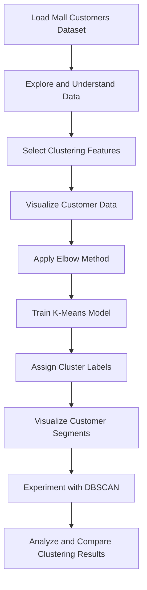

# 🛍️ Customer Segmentation Using Clustering

<p align="center">
  
  
  
  
  
</p>

<p align="center">
  <strong>Discover customer groups through unsupervised machine learning.</strong>
  <br>
  A data science project that explores customer behavior using annual income and spending score.
</p>

---

## 📌 Overview

Customer segmentation is a data analysis technique used to divide customers into groups with similar characteristics and behaviors.

This project applies **unsupervised machine learning** to the Mall Customers dataset to explore customer groups based on their **Annual Income** and **Spending Score**.

The primary algorithm is **K-Means Clustering**. The project also explores **DBSCAN** to investigate density-based clustering and compare its behavior with K-Means.

The project covers data exploration, preprocessing, cluster selection, model implementation, and visualization of the resulting customer segments.

## ✨ Key Features

- 📊 Exploratory Data Analysis (EDA) of customer data.
- 🧹 Data selection and preprocessing for clustering.
- 📈 Elbow Method to help select the number of K-Means clusters.
- 🤖 Implementation of K-Means clustering.
- 🎨 Visualization of customer segments.
- 🔬 DBSCAN experimentation for density-based clustering.
- 🧠 Exploration of unsupervised learning concepts and cluster interpretation.

## 📂 Dataset

**Dataset:** Mall Customers

The dataset contains customer information commonly used for customer segmentation exercises.

| Feature | Description |
|---|---|
| `CustomerID` | Unique identifier assigned to each customer |
| `Gender` | Customer gender |
| `Age` | Customer age |
| `Annual Income (k$)` | Annual income in thousands of dollars |
| `Spending Score (1-100)` | Score representing customer spending behavior |

For the main clustering analysis, **Annual Income** and **Spending Score** are used to explore customer segments.

## ⚙️ Project Workflow



## 🧪 Algorithms Used

### 1. K-Means Clustering

K-Means is an unsupervised learning algorithm that partitions data points into a predefined number of clusters.

**How it works:**

1. Select the number of clusters, \(K\).
2. Initialize cluster centroids.
3. Assign each data point to its nearest centroid.
4. Recalculate the centroids.
5. Repeat until the assignments or centroids stabilize.

**Elbow Method:** This technique evaluates the within-cluster sum of squares (WCSS) for different values of \(K\). The elbow point helps identify a reasonable cluster count.

### 2. DBSCAN Clustering

DBSCAN stands for *Density-Based Spatial Clustering of Applications with Noise*. It groups points in dense regions and identifies isolated points as noise.

Its main parameters are:

- `eps`: The maximum neighborhood distance between points.
- `min_samples`: The minimum number of neighboring points needed to form a dense region.

Unlike K-Means, DBSCAN does not require the number of clusters to be specified in advance. Its results depend on the data distribution and parameter choices.

## 📊 Model Evaluation and Visualization

Clustering is an unsupervised learning task, so it does not use ordinary classification accuracy unless suitable ground-truth labels are available.

The project focuses on interpreting the resulting clusters through visualizations and examining how the two algorithms group the data.

- **Elbow Method:** Helps choose a suitable number of K-Means clusters.
- **Cluster Visualization:** Displays the groups formed from annual income and spending score.
- **DBSCAN Exploration:** Shows how density-based clustering identifies groups and potential noise points.

> Note: The number of clusters and evaluation scores depend on the results produced by the notebook. No fixed accuracy score is claimed because this is a clustering project.

## 🛠️ Tech Stack

| Technology | Purpose |
|---|---|
| Python | Programming language |
| Pandas | Data loading and manipulation |
| NumPy | Numerical operations |
| Matplotlib | Data and cluster visualization |
| Scikit-learn | Clustering algorithms and machine learning utilities |
| Jupyter Notebook | Interactive development and experimentation |
| Google Colab | Cloud-based notebook execution |

## 📁 Repository Structure

```text
Customer-Segmentation-Using-Clustering/
│
├── Customer_Segmentation.ipynb   # Main analysis and clustering notebook
├── Mall_Customers.csv            # Dataset
├── README.md                     # Project documentation
└── requirements.txt              # Python dependencies
```

## 🚀 Getting Started

### Prerequisites

- Python 3.x
- Jupyter Notebook or Google Colab
- Git (optional, for cloning the repository)

### 1. Clone the Repository

```bash
git clone https://github.com/tanush090/Customer-Segmentation-Using-Clustering.git
```

### 2. Navigate to the Project Directory

```bash
cd Customer-Segmentation-Using-Clustering
```

### 3. Install Dependencies

```bash
pip install -r requirements.txt
```

### 4. Run the Notebook

Start Jupyter Notebook:

```bash
jupyter notebook
```

Open `Customer_Segmentation.ipynb` and run the cells in sequence.

Alternatively, upload the notebook and dataset to Google Colab and execute the notebook there.

## 🔮 Future Improvements

- Compare clustering results using the Silhouette Score where appropriate.
- Experiment with different K-Means cluster counts.
- Tune DBSCAN parameters systematically.
- Investigate the effect of feature scaling on clustering results.
- Develop an interactive dashboard for exploring customer segments.
- Extend the analysis with additional customer features.

## 👨‍💻 Author

**Tanush Kumar**

B.Tech — Computer Science Engineering (AI & ML)

- GitHub: [@tanush090](https://github.com/tanush090)

---

<p align="center">
  <strong>Learning Machine Learning, One Project at a Time 🚀</strong>
</p>
